I grew up obsessed with dragonflies and rockets, so I studied aeronautical engineering to build things that fly.
Then I found out software flies faster.

Now I'm a co-founder & CTO, building AI that has to survive the real world, not just a demo.

**On approach:** **Dashlytics** turns raw business data into dashboards that tell you what's working, what needs attention, and what you're missing · **Mythos** helps you pitch and tell stories people remember.

The board updates itself every day from my repos. If it says IN FLIGHT, I touched it this week.

  

<!-- add more comms channels here, e.g. LinkedIn / X / Instagram badges -->

